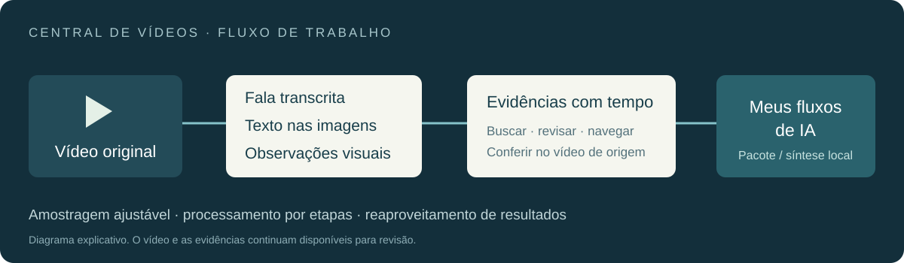
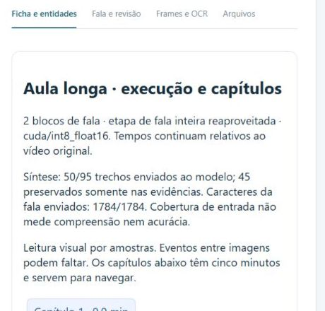

# CentralVideo

**In development** 
Estimated start: September 2026 · Last recorded update: November 3, 2026 
Presentation updated on November 17, 2026.

**Making video content usable by my own AI assistants, with control over the processing.**

[Português](README.md) · [Portfolio](https://github.com/EagleKhan0505)

I wanted to bring videos into my AI workflows without adding another video-analysis subscription. I also wanted to decide what to extract, how much processing to spend, and how to return to the original moment when an answer needed checking. That is where CentralVideo started.

The application turns a video into material an assistant can consult: speech transcripts, text detected in frames, visual observations and timestamps. Local processing uses my existing computer and models, without a paid video-analysis API in this workflow. Hardware and electricity still have a cost.

*Diagram of the implemented workflow, not an application screenshot.*

## From a file to a useful moment

Speech recognition handles the audio, OCR reads selected frames, and visual analysis adds information that speech alone cannot provide. The outputs retain their relationship to the video's timeline.

I can search for a term, jump to its timestamp, review the transcript and export a package for other AI workflows. Local synthesis is an additional stage; the underlying evidence remains available for inspection.

Sampling is an important design decision. Processing every frame can be impractical on the available machine. Frame selection, OCR and vision budgets, chunked transcription and stage reuse let me adjust the workload. A synthesis problem does not necessarily require repeating extraction.

## A concrete iteration

One interface test revealed that a completed pipeline had supplied only part of the transcript to synthesis. After a correction, the targeted retest sent **1,784 out of 1,784 transcript characters**. The interface also reported **50 out of 95 evidence excerpts** selected for the model, with the others preserved separately.

These are coverage counts from that test, not an AI accuracy score. The screenshot comes from version 2.4 on November 3, 2026. The test video was about 86 seconds long. Searching for a term and jumping to its moment around the 60-second mark were also checked through the interface.

 

## The engineering work behind it

The project combines video processing, transcription quality, evidence selection and compute constraints. I use the hypothesis-driven approach I developed through research to investigate bottlenecks and evaluate changes.

The implementation uses Python, FFmpeg/PyAV, faster-whisper, OCR and local models through Ollama. A long-lecture profile is in development; the test shown here does not establish performance on multi-hour recordings. Extracted and generated content still needs review.

This repository contains selected documentation and evidence. The complete application, working videos and configuration remain private.
