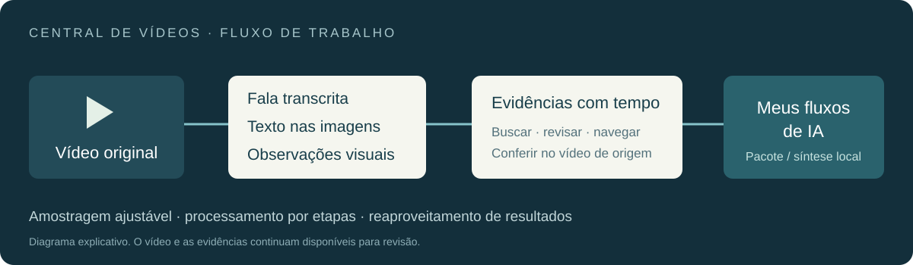
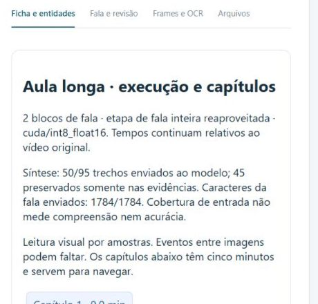

# Central de Vídeos

**Em desenvolvimento** 
Início estimado: 09/2026 · Última atualização registrada: 03/11/2026 
Apresentação atualizada em 17/11/2026.

**Uma forma de dar aos meus assistentes de IA acesso ao conteúdo dos vídeos, com controle sobre o processamento.**

[English](README.en.md) · [Portfólio](https://github.com/EagleKhan0505)

Eu queria usar vídeos nos meus próprios fluxos de IA, sem depender de mais uma assinatura para conseguir analisá-los. Também queria poder escolher o que extrair, quanto tempo gastar e como voltar ao trecho original quando uma resposta parecesse duvidosa. A Central nasceu dessa necessidade.

O programa transforma o vídeo em material que um assistente consegue consultar: fala transcrita, texto encontrado nas imagens, observações visuais e referências de tempo. O processamento local aproveita o computador e os modelos que já uso. Nesse fluxo, não há contratação de uma API paga para analisar o vídeo; o custo de hardware e energia continua existindo.

*Esquema do fluxo implementado; não é uma captura da interface.*

## Do arquivo ao trecho que importa

Ao receber um vídeo, a Central separa o trabalho em etapas. A transcrição cuida da fala; o OCR lê texto em quadros selecionados; a análise visual acrescenta informações que o áudio não contém. Cada resultado mantém sua relação com o tempo do vídeo.

Isso permite procurar um termo e voltar ao instante correspondente, revisar a transcrição e reunir os materiais em um pacote para outros fluxos de IA. A síntese local é uma etapa adicional: as evidências continuam disponíveis para conferência.

O controle de amostragem é parte importante do projeto. Processar todas as imagens pode tornar o trabalho inviável no computador disponível. Por isso, desenvolvi opções de seleção de quadros, orçamento de OCR e visão, processamento de fala em blocos e reaproveitamento de etapas já concluídas. Posso investigar um problema na síntese sem necessariamente refazer toda a extração.

## Uma correção que mostra como o projeto evolui

Em um teste pela interface, o processamento terminava, mas a síntese recebia apenas parte da fala. Esse foi um dos gargalos que precisei investigar: concluir uma etapa não garantia que o material relevante tivesse chegado à seguinte.

Depois do ajuste, o reteste enviou **1.784 de 1.784 caracteres da transcrição** à síntese. A interface também passou a explicitar que **50 de 95 excertos** foram enviados ao modelo e que os demais continuavam nas evidências. São medidas de cobertura daquele teste, não uma taxa de acerto da IA.

O registro ao lado é um recorte real da versão 2.4, em 03/11/2026. O vídeo usado tinha cerca de 86 segundos; a busca por um termo e a navegação ao instante de aproximadamente 60 segundos também foram verificadas na interface.

 

## O que estou aprendendo a equilibrar

Este projeto junta questões que, no início, pareciam separadas: edição e leitura de vídeo, qualidade de transcrição, escolha de evidências e tempo de processamento. Minha experiência em pesquisa ajuda a formular hipóteses sobre os gargalos e comparar o resultado de cada mudança.

A implementação usa Python, FFmpeg/PyAV, faster-whisper, OCR e modelos locais via Ollama. O perfil para aulas longas está em desenvolvimento; o teste acima não comprova desempenho em gravações de várias horas. Transcrição, OCR e descrições visuais ainda exigem revisão.

Este repositório reúne a apresentação e evidências selecionadas. A aplicação completa, os vídeos de trabalho e suas configurações permanecem privados.
