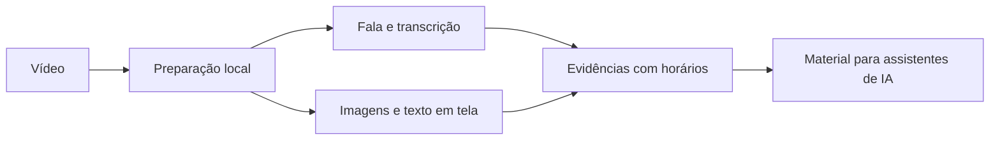

# Central de Vídeos

**Uma forma de permitir que meus assistentes de IA consumam vídeos, com um processamento que eu consigo ajustar e otimizar.**

[English](README.en.md) · [Gustavo Amaral](https://github.com/EagleKhan0505)

## Por que criei

Encontrei uma limitação recorrente no meu uso de IA: os assistentes que eu utilizava nem sempre conseguiam receber ou interpretar diretamente um vídeo. Mesmo quando parte do conteúdo era acessível, era difícil controlar quais informações chegavam ao modelo.

Criei a Central para transformar o vídeo em um conjunto organizado de fala, imagens, texto em tela e referências temporais. Assim, consigo preparar o conteúdo para meus próprios fluxos de IA e decidir onde investir processamento, aproveitando o computador e os modelos locais que já tenho, **sem contratar um serviço adicional de análise de vídeo nem pagar uma API para o processamento local**.

## Como funciona

## O que desenvolvi

- Interface local para receber vídeos, acompanhar etapas e consultar resultados.
- Transcrição de áudio, seleção de imagens, OCR e recursos de análise visual.
- Organização de evidências com horários para voltar ao trecho de origem.
- Parâmetros de amostragem e perfis de processamento para equilibrar cobertura, tempo e uso do computador.
- Reutilização de resultados compatíveis, checkpoints e histórico de execuções.
- Exportação de material estruturado para análise nos meus fluxos de IA.

## Minha contribuição

Parti de uma necessidade do meu próprio uso, defini o fluxo e conduzi a integração das ferramentas com apoio de IA no desenvolvimento. Uso testes, inspeção dos resultados e investigação de gargalos para decidir o que precisa ser refinado.

## Estado atual

Aplicação local em desenvolvimento, com processamento de vídeos reais e registros de avaliação. O perfil de aulas longas está implementado; a validação de gravações de várias horas permanece uma etapa de evolução. A cobertura depende das configurações escolhidas, e transcrições e interpretações continuam sujeitas a revisão.

**Tecnologias:** Python, FFmpeg, faster-whisper, OCR, modelos locais e Ollama.

Esta é a apresentação pública do projeto. O código da aplicação, os modelos e os vídeos de trabalho não são distribuídos neste repositório.
